  

> Deuxième version : proxy EuRIS en PHP, tâche planifiée et pilotage d'un relais.

  

**Statut** — 🟡 Deuxième itération, remplacée depuis par `trackship-backend` et `trackship-mobile`

---

# TrackShip 2

## Le problème

La première version ne surveillait que si quelqu'un avait la page ouverte. Pour détecter un navire la nuit, il faut quelque chose qui tourne sans personne devant l'écran.

## Ce que fait le projet

- Une tâche planifiée (`cron/tick.php`) qui interroge EuRIS à intervalle régulier
- Un état persistant, pour ne pas renotifier un navire déjà vu
- Le pilotage d'un relais Shelly, afin de déclencher un signal physique à l'arrivée d'un navire
- Le proxy EuRIS repris de la première version

## Structure

`euris-proxy.php` · `cron/tick.php` · `api/state.php` · `api/shelly.php` et `api/shelly-status.php` · `api/auth.php` · `Dockerfile`

## Lancer le projet

`docker build -t trackship2 . && docker run -p 8080:80 trackship2`. Déclarer la tâche planifiée pour appeler `cron/tick.php`.

---

Développé par **Bakari Abidina** · [bakabi.fr](https://bakabi.fr)
